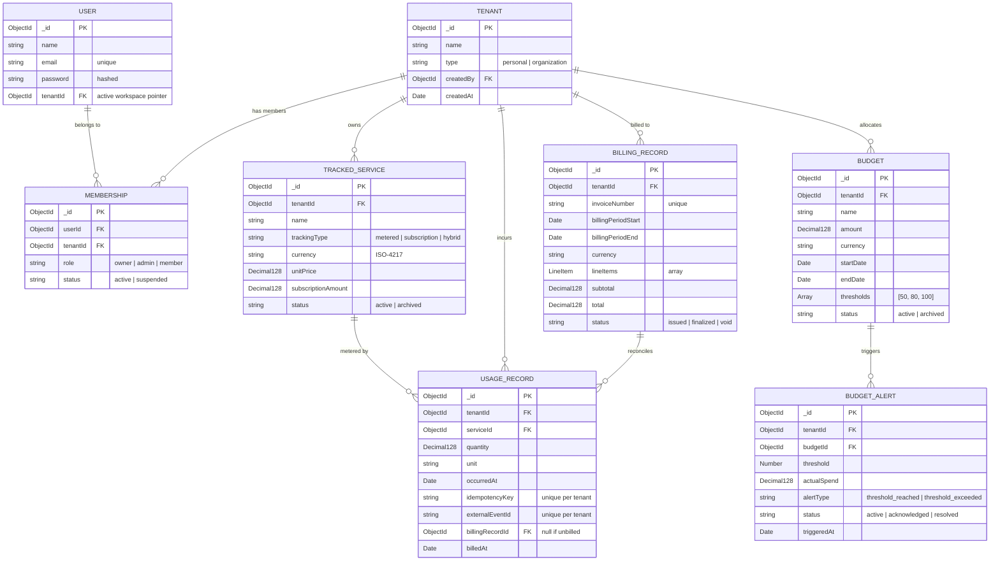

# MeterFlow — Academic & Technical Project Report Notes

This document contains verified technical documentation, architectural details, and empirical findings compiled for the academic project report and defense presentation of **MeterFlow**.

---

## 1. Project Overview & Problem Statement

- **Project Title:** MeterFlow: A Multi-Tenant SaaS Metered Billing Platform with Predictive Spend Alerts
- **Domain:** Cloud Computing, Multi-Tenant SaaS Engineering, Financial Technology (FinTech), Usage-Based Billing Systems
- **Problem Statement:**  
  Modern digital infrastructure, cloud services, and AI APIs increasingly bill customers on dynamic consumption (e.g., token consumption, GPU runtime, bandwidth, API calls). Organizations and engineering teams face three primary challenges:
  1. *Unpredictable Spend & Budget Overruns:* Lack of real-time spend tracking and early alerting leads to surprise invoices at the end of billing cycles.
  2. *Billing Inaccuracies & Duplication:* Network retries and distributed event ingestion frequently cause double-counting or orphaned usage records if idempotency is not strictly enforced.
  3. *Tenant Data Leakage:* Multi-tenant platforms must guarantee strict organizational data isolation, ensuring users can participate in personal and enterprise workspaces without cross-boundary contamination.
- **Project Objectives:**
  - Build a production-grade, multi-tenant backend architecture supporting personal and organization workspaces with role-based access control (`owner`, `admin`, `member`).
  - Implement a flexible service catalog supporting three modern billing models: `metered`, `subscription`, and `hybrid`.
  - Provide database-enforced idempotency for high-throughput usage ingestion.
  - Design a high-precision billing engine that calculates charges using arbitrary-precision decimal arithmetic and reconciles usage records to prevent duplicate invoicing.
  - Implement workspace-level budgets, actual spend measurement from finalized invoices, deterministic multi-threshold spend alerts, and explainable spending forecasts.

---

## 2. System Architecture & Technology Stack

```
+---------------------------------------------------------------------------------+
|                               Client / API Consumers                           |
|                       (HTTP REST with Bearer JWT Authorization)                 |
+---------------------------------------------------------------------------------+
                                       |
                                       v
+---------------------------------------------------------------------------------+
|                       Express.js API Layer (Node.js v24+)                       |
|   - Security Headers (Helmet)               - CORS Middleware                   |
|   - Request Body Parsers (JSON)             - Centralized Error Sanitizer       |
+---------------------------------------------------------------------------------+
                                       |
                   +-------------------+-------------------+
                   |                                       |
                   v                                       v
+-------------------------------------+ +-----------------------------------------+
|     Authentication & RBAC Layer     | |       Operational Telemetry Layer       |
| - JWT Signature & Expiry Check      | | - Health Check (/api/health)            |
| - Tenant Membership Verification    | | - Graceful Shutdown (SIGTERM/SIGINT)    |
| - Role Authorization (owner/admin)  | | - Env Validation (validateEnv)          |
| - Anti-Privilege Escalation Guard   | | - Mongoose Connection Monitor           |
+-------------------------------------+ +-----------------------------------------+
                   |
                   v
+---------------------------------------------------------------------------------+
|                         Core Application Services & Engines                     |
|                                                                                 |
|  +--------------------+  +----------------------+  +-------------------------+  |
|  |  Workspace Engine  |  |   Catalog Engine     |  |   Ingestion Engine      |  |
|  | - Personal / Org   |  | - Metered / Sub /    |  | - Idempotency Manager   |  |
|  | - Context Switch   |  |   Hybrid Services    |  | - Date Range Filter     |  |
|  | - Member Roles     |  | - Status Lifecycle   |  | - Aggregation Pipeline  |  |
|  +--------------------+  +----------------------+  +-------------------------+  |
|                                                                                 |
|  +--------------------+  +----------------------+  +-------------------------+  |
|  |   Billing Engine   |  |    Budget Engine     |  |   Forecasting Engine    |  |
|  | - Decimal.js Math  |  | - Actual Spend Calc  |  | - Linear Run-Rate       |  |
|  | - Period Boundary  |  | - Multi-Threshold    |  | - Data Window Guard     |  |
|  | - Usage Reconciler |  |   Alert Evaluator    |  | - Explainable Notes     |  |
|  +--------------------+  +----------------------+  +-------------------------+  |
+---------------------------------------------------------------------------------+
                                       |
                                       v
+---------------------------------------------------------------------------------+
|                         Persistence Layer (MongoDB 9+)                          |
|  - Tenant, User, Membership                                                     |
|  - TrackedService, UsageRecord (Compound Unique Idempotency Indexes)             |
|  - BillingRecord (Decimal128, Unique Period Invoice Constraint)                 |
|  - Budget, BudgetAlert (Unique Threshold Index)                                 |
+---------------------------------------------------------------------------------+
```

### Technology Justifications

| Component | Technology | Technical Justification |
|---|---|---|
| **Runtime** | Node.js (v24 LTS) | High-performance asynchronous non-blocking I/O ideal for API gateways and event ingestion. Native test runner (`node:test`) eliminates heavy external test frameworks. |
| **Language** | ECMAScript Modules (ESM) | Modern, native standard modularity across all source and test files (`import`/`export`). |
| **Framework** | Express.js (v5) | Robust HTTP routing, mature middleware pipeline, and full compatibility with custom security middleware. |
| **Database** | MongoDB Atlas & Mongoose (v9) | Flexible multi-tenant document store with native schema validation, compound unique indexing, and `Decimal128` data type support. |
| **Precision Math** | Decimal.js | Eliminates IEEE 754 floating-point inaccuracies (e.g. `0.1 + 0.2 !== 0.3`). Enforces consistent `ROUND_HALF_UP` financial rounding. |
| **Security** | Helmet, CORS, bcryptjs, jsonwebtoken | Industry-standard defense-in-depth: salted hashing (10 rounds), signed stateless tokens, restricted HTTP headers. |

---

## 3. Data Models & Relational Architecture

### Entity-Relationship Diagram



### Critical Database Indexes & Constraints
1. **Workspace Membership Uniqueness:**
   `{ userId: 1, tenantId: 1 }` (unique) prevents duplicate memberships for the same user in a workspace.
2. **Ingestion Idempotency:**
   - `{ tenantId: 1, idempotencyKey: 1 }` (unique, sparse) ensures client-provided replay tokens never duplicate usage.
   - `{ tenantId: 1, externalEventId: 1 }` (unique, sparse) protects vendor event IDs against re-ingestion.
3. **Billing Invoice Uniqueness:**
   `{ tenantId: 1, billingPeriodStart: 1, billingPeriodEnd: 1, currency: 1 }` (unique) guarantees that at most one invoice exists for any period/currency pair per workspace.
4. **Budget Alert Deduping:**
   `{ budgetId: 1, periodStart: 1, periodEnd: 1, threshold: 1 }` (unique) guarantees that repeated evaluations never create duplicate threshold alert documents.

---

## 4. Key Engineering Modules & Methodologies

### 4.1 Ingestion & Idempotency Engine
- Ingestion accepts raw usage events with strict unit validation against the service catalog.
- If an event arrives with an existing `idempotencyKey` or `externalEventId`:
  - **Identical payload:** Returns HTTP `200 OK` with `idempotentReplay: true` and the existing record.
  - **Conflicting payload:** Returns HTTP `409 Conflict` to indicate a payload mismatch with an existing key.
  - **Concurrent arrival:** Handled cleanly via code 11000 duplicate key catch, fetching the winning document.

### 4.2 High-Precision Billing & Self-Healing Reconciliation
- **Formula:**
  $$\text{LineItem}_{\text{sub}} = \text{subscriptionAmount} \times \text{periodFactor}$$
  $$\text{LineItem}_{\text{usage}} = \sum \text{quantity} \times \text{unitPrice}$$
  $$\text{Subtotal} = \sum \text{LineItems}$$
- **Usage Reconciliation:** When an invoice is created, all associated unbilled usage events have their `billingRecordId` updated to the invoice ID, and `billedAt` timestamped.
- **Self-Healing:** If an invoice generation was interrupted before usage record linking completed, subsequent generation requests or retrieval (`GET /api/billing/:id/usage`) automatically reconcile any orphaned records matching the bill's `usageRecordIds` or period boundaries.

### 4.3 Spend Measurement & Budget Alerts
- **Measurement Policy:** Actual spend is computed strictly by summing the `total` of finalized and issued `BillingRecord` documents within the budget's calendar dates. Raw unbilled usage is never counted as realized monetary spend.
- **Alert Dispatch:** Evaluates thresholds in sorted order. If spend jumps from 0% to 125%, all crossed thresholds (50%, 80%, 100%, 120%) are created in a single evaluation run.
- **Classification:** Thresholds < 100% are tagged `alertType: "threshold_reached"`; thresholds >= 100% are tagged `alertType: "threshold_exceeded"`.

### 4.4 Explainable Spending Forecasting
- Uses linear run-rate extrapolation from historical daily spending:
  $$\text{BurnRate} = \frac{\text{ActualSpend}}{\text{DaysElapsed}}$$
  $$\text{ForecastSpend} = \text{ActualSpend} + (\text{BurnRate} \times \text{DaysRemaining})$$
- **Guardrails:** Requires at least 24 hours of elapsed data in the active budget period. If evaluating prior to start date or within the first 24 hours, explicitly returns `hasSufficientData: false` along with descriptive limitations, preventing misleading projections.

---

## 5. Security Architecture & Threat Mitigation

| Threat Vector | Mitigation Strategy Implemented |
|---|---|
| **Cross-Tenant Data Exposure** | Every database query is strictly filtered by `tenantId: req.user.tenantId`. Attempts to access resources belonging to other workspaces return 404 or 403. |
| **Privilege Escalation via Auto-Heal** | Auto-heal legacy membership logic checks whether an `owner` membership already exists. If an owner exists, auto-heal is disabled, preventing removed or unauthorized users from gaining owner privileges. |
| **Suspended Member Access** | `authMiddleware` checks `membership.status !== "active"` and immediately terminates requests with HTTP 403. |
| **Information Leakage in Production** | When `NODE_ENV=production`, the centralized error handler converts all unhandled 500 exceptions into a generic `"Internal server error"`, masking stack traces and database connection strings. |
| **Weak Secret Exploitation** | Startup environment validation (`validateEnv`) enforces that `JWT_SECRET` must be at least 16 characters in production environments. |
| **Denial of Service via Unbounded Pagination** | Query limits across usage, billing, and budget lists are clamped to `Math.min(100, Math.max(1, limit))`. |

---

## 6. Testing Strategy & Empirical Verification

- **Testing Methodology:** Multi-tier automated testing including unit calculations, API endpoint tests, integration pipelines, and full business lifecycle workflows.
- **Execution Harness:** Node native test runner (`node:test`) with an embedded in-memory MongoDB runner (`mongodb-memory-server`), ensuring 100% offline reproducibility without external database flakiness.
- **Empirical Test Results:**
  - **Total Tests:** 140
  - **Suites:** 45
  - **Passed:** 140
  - **Failed:** 0
  - **Skipped:** 0
  - **Total Execution Duration:** ~210 seconds

---

## 7. Known Limitations & Future Scope

1. **Single-Currency Invoicing:** Invoices and budgets currently support a single currency per document. Multi-currency consolidation with real-time exchange rates represents an opportunity for future expansion.
2. **Deterministic vs. Stochastic Forecasting:** The current forecasting engine uses deterministic linear run-rate extrapolation. Future iterations can integrate time-series machine learning models (e.g. ARIMA, Prophet) to model seasonality, weekend dips, and nonlinear consumption surges.
3. **Payment Gateway Integration:** The platform handles billing calculations, invoice generation, and status lifecycles (`issued`, `finalized`, `void`), but defers actual credit card or wire transfer processing to external gateways (Stripe, Adyen).
4. **Distributed Transactions:** The system relies on database compound unique indexes and self-healing reconciliation helpers rather than multi-document MongoDB replica-set transactions, allowing deployment on standalone MongoDB configurations.
